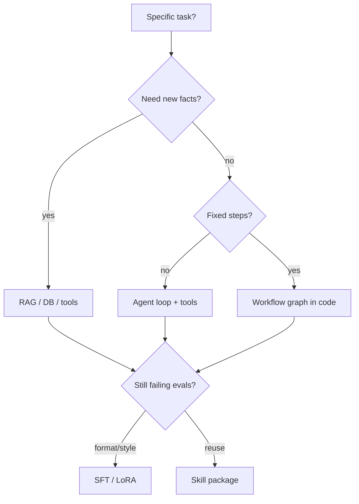
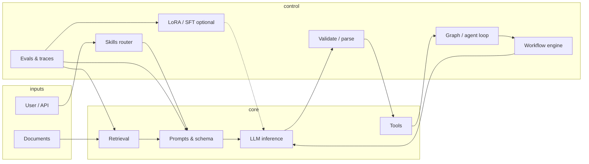

# Roadmap: Learn AI tools & logic (local-first)

This repo is a **hands-on lab**: run models on your machine, then layer real software—clients, tools, retrieval, agents—on top. The goal is not to memorize buzzwords; it is to **design, implement, and debug** systems where an LLM is one component among many.

**Anchor setup:** [README.md](./README.md) — Qwen3 1.7B via `llama-server` at `http://127.0.0.1:8080/v1`.

---

## North star

By the end of this roadmap you should be able to:

1. **Call and control** local (and optionally cloud) models from code with clear contracts.
2. **Compose logic** around the model: validation, retries, state, tool execution, guardrails.
3. **Ground answers** in your data (RAG) without treating the model as a database.
4. **Build small agents** and **workflows** that plan → act → observe—with clear state and recovery.
5. **Package reusable skills** (instructions + tools + evals) instead of one-off prompts.
6. **Adapt models** for a specific task when prompting/RAG are not enough—and know when *not* to train.
7. **Measure quality** with evals and logs, not vibes.

**Capstone (pick one and ship it):**

| Track | Capstone idea |
|-------|----------------|
| **Developer tool** | CLI or VS Code/Cursor helper: “explain this repo,” “run safe refactors,” wired to your codebase via RAG + tools. |
| **Personal assistant** | Local chat app with memory, calendar/file tools, and strict permission boundaries. |
| **Automation** | Job that ingests docs/tickets, classifies, drafts responses, and only auto-sends when confidence + rules pass. |
| **Learning lab** | Interactive tutor over your own notes (RAG) with quizzes generated and graded by structured outputs. |

---

## How to use this roadmap

- **30 min/day schedule:** follow **[DAILY_30MIN.md](./DAILY_30MIN.md)** (day-by-day tasks through ~12 weeks).
- **Per-phase deep dives:** [phases.md](./phases.md) → [phase0.md](./phase0.md) … [phase7.md](./phase7.md).
- **Order matters loosely** — phases build on each other, but you can parallelize (e.g. evals while learning RAG).
- **Every phase ends with a demo** you can run in &lt; 2 minutes and explain in one paragraph.
- **Keep a learning log** in `docs/journal/` (date, what broke, what you fixed)—that is part of the skill.
- **Prefer small repos inside this workspace** (`tools/`, `apps/`, `experiments/`) over one giant folder.

Suggested pace (adjust to your schedule):

| Phase | Focus | Typical duration |
|-------|--------|------------------|
| 0–1 | Runtime + API clients | 1–2 weeks |
| 2–3 | Prompts, structure, tools | 2–3 weeks |
| 4 | RAG | 2–3 weeks |
| 5 | Agents & workflows | 2–4 weeks |
| 6 | Evals & hardening | ongoing |
| 7 | Training for specific tasks | 2–4 weeks (optional) |
| 8 | Skills packaging & composition | 1–2 weeks |
| 9 | Advanced ops & multimodal | as needed |

---

## Decide first: prompt vs RAG vs train vs workflow vs skill

Use this ladder before you reach for fine-tuning or a complex agent:

| Need | Try first | Then | Last resort |
|------|-----------|------|-------------|
| Answer from your docs | Better chunks + RAG | Bigger context / reranker | Fine-tune on *style*, not facts |
| Reliable JSON / format | Schema + validator + retry | Few-shot examples in prompt | SFT on 500–5k format examples |
| New capability (API, DB) | **Tool** + description | Skill doc + examples | Train model to call tools (usually unnecessary) |
| Multi-step business process | **Workflow** (code owns order) | Agent inside one step | Fully autonomous agent for whole pipeline |
| Same behavior in many projects | **Skill** (versioned bundle) | Shared MCP server | Copy-paste prompts (drift) |

**Rule of thumb:** Training changes *habits* (tone, format, tool-use style). **Facts** live in retrieval, databases, or tools—not in weights. Workflows own **correct order and side effects**; agents own **ambiguous planning** inside a step.



---

## Phase 0 — Runtime & mental model ✅ (started)

**Purpose:** Understand what “running AI” means on your laptop.

**Concepts**

- Tokens, context window (`-c 4096`), quantization (Q4_K_M), latency vs quality.
- OpenAI-compatible HTTP API: chat completions, streaming, model list.
- Local vs cloud: privacy, cost, rate limits, when to use which.

**You already have**

- `llama-server` + Qwen3 1.7B GGUF.
- Health and `/v1/models` checks.

**Exercises**

1. Run a **streaming** completion with `curl` and watch tokens arrive.
2. Change `-c` and observe failures or truncation on long prompts.
3. Read one full JSON response: `choices`, `usage`, `finish_reason`.
4. Optional: try a **larger** GGUF on the same server flags and compare speed/quality.

**Done when:** You can start/stop the server and explain tokens + context to another engineer.

---

## Phase 1 — Clients & application skeleton

**Purpose:** Treat the model as an **HTTP dependency** with timeouts, errors, and tests.

**Concepts**

- SDK vs raw HTTP; base URL `http://127.0.0.1:8080/v1`.
- System / user / assistant messages; conversation state.
- Streaming to stdout or UI; cancellation.

**Build**

```
tools/
  llm_client/          # thin wrapper: chat(), stream_chat(), health()
experiments/
  01_hello_chat.py     # or .ts — your pick
```

**Exercises**

1. Implement `chat(messages) -> str` with 30s timeout and clear errors if server is down.
2. Add **streaming** and print incremental deltas.
3. Write a **unit test** that mocks HTTP (no model required in CI).
4. CLI: `python -m tools.llm_client "Your question"` 

**Done when:** One language client library + CLI demo + tests.

**Stretch:** Support both local server and OpenAI-compatible cloud via env vars (`LLM_BASE_URL`, `LLM_API_KEY`).

---

## Phase 2 — Prompting & structured logic

**Purpose:** Stop “one big string” prompts; use **patterns** you can version and test.

**Concepts**

- Instructions vs examples (few-shot); role of system prompt.
- Temperature, top_p, max_tokens—when they help and when they hurt.
- **Structured output**: JSON schema, XML tags, “answer in this format.”
- Parsing failures: repair loop, validate with Pydantic/Zod, retry once with error feedback.

**Build**

```
tools/
  prompts/             # versioned .md or .yaml templates
  structured/          # parse_json_from_llm(), validators
experiments/
  02_extract_entities.py
  03_classify_intent.py
```

**Exercises**

1. **Classifier**: map user text → `{ intent, confidence, slots }` with schema validation.
2. **Extractor**: pull dates, names, or action items from notes into JSON.
3. Keep a **prompt changelog** (v1, v2) and note behavior differences.
4. For Qwen3: learn when to disable “thinking” / reasoning modes if responses get verbose (model-specific docs).

**Done when:** Three prompt templates with parsers and golden-file tests (input → expected JSON).

---

## Phase 3 — Tools (function calling) & side effects

**Purpose:** Models **propose** actions; your code **executes** them safely.

**Concepts**

- Tool definitions (name, description, JSON parameters).
- The loop: model → tool_call → run function → tool result → model.
- Idempotency, permissions, sandboxing (never `eval` user input).
- MCP as a standard way to expose tools (optional but valuable).

**Build**

```
tools/
  registry.py          # register_tool(name, fn, schema)
  builtins/            # read_file, search_web (careful), run_shell (deny by default)
apps/
  tool_runner/         # REPL: user chat + visible tool traces
```

**Exercises**

1. **Calculator + clock**: trivial tools to learn the loop.
2. **File reader**: read only under `data/`; reject path traversal.
3. **Git status** tool (read-only): model summarizes repo state from real `git` output.
4. Log every tool call: arguments, duration, result size.

**Done when:** Chat session where the model uses ≥2 tools and you can replay the trace from logs.

**Stretch:** Expose the same tools via a minimal **MCP server** so Cursor can call them.

---

## Phase 4 — RAG (retrieval-augmented generation)

**Purpose:** Answer from **your** documents, with citations and honest “I don’t know.”

**Concepts**

- Chunking, overlap, metadata (source, page, path).
- Embeddings: local (e.g. small embedding model) vs API.
- Vector store: in-memory, sqlite-vss, LanceDB, Chroma—start simple.
- Retrieval: top-k, MMR, hybrid (keyword + vector).
- Prompt assembly: context blocks + user question; cite sources in the answer.

**Build**

```
data/
  corpus/              # markdown, pdfs, exports
tools/
  ingest/              # chunk, embed, index
  rag/                 # retrieve(), answer_with_citations()
apps/
  ask_my_docs/         # CLI or tiny web UI
```

**Exercises**

1. Index `docs/` + a few of your own notes; ask questions with **source paths** in the answer.
2. Compare answers with RAG on vs off on the same questions.
3. Break it on purpose: wrong chunk size, stale index—learn failure modes.
4. Add **reranking** or keyword fallback when vector search misses.

**Done when:** “Ask my docs” app with ingest command + 5 question eval set you wrote yourself.

---

## Phase 5 — Agents & multi-step workflows

**Purpose:** Chain steps with **state**, not one-shot prompts. Separate **workflows** (you define the graph) from **agents** (model chooses the next move inside a bounded step).

### Agents (dynamic)

**Concepts**

- ReAct: reason → tool call → observation → repeat until stop condition.
- Plan-and-execute: planner emits steps; executor runs tools; optional replan.
- Bounded context: one objective per thread; summarize or drop old turns.
- Human-in-the-loop for writes, sends, payments, deletes.

### Workflows (deterministic)

**Concepts**

- DAG or state machine: `ingest → classify → retrieve → draft → human_approve → send`.
- LLM nodes are **pure-ish** (input state → output patch); branching is **code** (`if confidence < 0.8 → escalate`).
- Retries, timeouts, idempotency keys, dead-letter queue for failed steps.
- **Durable execution**: persist run id + step status so a crash resumes at `step 3`, not from scratch.

| Pattern | Who decides next step? | Best for |
|---------|------------------------|----------|
| Workflow | Your code / graph | Invoices, ETL, CI-style pipelines |
| Agent | Model + tool loop | Research, exploratory coding, vague goals |
| Hybrid | Workflow calls agent sub-routine | “Triage ticket” (fixed) then “draft reply” (agent) |

**Build**

```
apps/
  agent_lab/
    agent_loop.py        # ReAct with max_steps, tool trace
    workflow.py          # explicit graph: nodes + edges + persistence
    memory.py            # thread store + optional long-term
    checkpoints/         # json/sqlite per run_id
```

**Exercises**

1. **Workflow**: ticket → classify (LLM) → if `billing` route to RAG on `data/billing/` → draft → **wait for approve** → log only (no send).
2. **Agent**: research task over `data/corpus/` with read-only tools and max 10 steps.
3. **Hybrid**: workflow step `run_research_agent(goal)` returns structured summary into next step.
4. Crash test: kill process mid-workflow; resume from checkpoint.

**Done when:** One hybrid run with checkpoint file, full jsonl trace, and a diagram in `docs/journal/`.

**Libraries (pick one after hand-rolling once):** LangGraph, Temporal + thin LLM wrapper, Prefect, or plain asyncio + sqlite state.

---

## Phase 8 — Agentic workflows at scale (optional depth)

**Purpose:** Production-shaped orchestration—not a bigger prompt.

**Concepts**

- **Supervisor / worker**: planner assigns subtasks to specialized agents (each with its own tools and skill).
- **Event-driven**: webhook → queue → worker; LLM never blocks HTTP.
- **Concurrency**: multiple runs; per-tenant limits; rate limit local `llama-server`.
- **Guardrails layer**: input/output filters, PII redaction, tool allowlists per workflow.
- **Cost/latency budget**: max tokens per run; fallback to smaller model for classify-only steps.

**Exercises**

1. Split capstone into two agents: `Researcher` (read) + `Writer` (markdown) with a handoff schema.
2. Queue: enqueue 10 jobs; worker pool of 1 (local GPU) processes sequentially with status API.
3. Document failure modes: infinite tool loop, context overflow, hallucinated tool args—and your mitigations.

**Done when:** Multi-run dashboard or CLI `workflow status <run_id>` backed by persisted state.

---

## Phase 6 — Evaluation, observability & production habits

**Purpose:** Know if changes **help or hurt** before you trust the system.

**Concepts**

- Golden datasets: input, expected properties (not always exact text).
- LLM-as-judge (careful bias) vs rule-based checks (JSON schema, regex, unit tests).
- Tracing: prompt hash, model, latency, token usage, tool calls.
- Regression when you change prompts, models, or chunk size.

**Build**

```
evals/
  sets/                # yaml/json cases
  run_eval.py          # scores + report
logs/
  traces/              # jsonl per session
```

**Exercises**

1. 20-case eval for your Phase 2 classifier; track accuracy over prompt versions.
2. 10-case RAG eval: requires citation contains correct file name.
3. Dashboard or simple markdown report after each `run_eval`.
4. Add `--tag v0.3` to traces and correlate with eval scores.

**Done when:** One command runs evals and fails CI (or exits non-zero) when score drops below a threshold.

---

## Phase 7 — Training & adaptation for a specific task

**Purpose:** Improve **repeatable behavior** (format, tone, classification boundaries, tool-call style)—not to memorize your wiki.

### When training helps vs hurts

| Good fit | Poor fit |
|----------|----------|
| Steady output schema (JSON labels, ticket categories) | Storing product catalog that changes weekly |
| Domain phrasing (support tone, legal disclaimers) | Multi-hop reasoning needing fresh web data |
| Imitating trajectories (tool call sequences) | Replacing a workflow engine |

Always have **evals before and after** (Phase 6). If prompting + few-shot gets you to 90%, training is optional.

### Methods (simplest → heavier)

| Method | Data | Compute | Local Qwen3 note |
|--------|------|---------|------------------|
| **Few-shot in prompt** | 3–20 examples | None | Start here |
| **SFT** (supervised fine-tune) | Hundreds–thousands of `(input, output)` | GPU hours | Teach format + task |
| **LoRA / QLoRA** | Same as SFT, smaller update | Less VRAM | Practical on one Mac for small models |
| **DPO / preference** | Pairs: good vs bad answer | More setup | Align style after SFT |
| **Distillation** | Teacher (big cloud) → student (local) | Teacher cost | Shrink behavior into 1.7B |

### Practical pipeline (recommended order)

1. **Collect**: export real failures from traces (Phase 6)—bad JSON, wrong label, missed tool.
2. **Curate**: 200–2k high-quality rows; dedupe; strip PII.
3. **Baseline eval**: score current Qwen3 + prompt on held-out set.
4. **SFT with LoRA** on a base **non-quantized** or training-friendly checkpoint (train in HF/Unsloth/Axolotl; **export GGUF** for `llama-server`).
5. **Merge LoRA → full weights → quantize** (Q4_K_M) for local inference.
6. **Re-run eval**; only ship if metrics beat baseline without regressions on a **general** smoke set.

**Build**

```
training/
  datasets/            # jsonl: messages or instruction/response
  scripts/
    prepare.py         # normalize, split, validate schema
    train_lora.py      # or notebook; document hyperparams
    export_gguf.sh     # merge + convert for llama.cpp
  configs/
    qwen3-1.7b-lora.yaml
evals/
  task_specific/       # same cases pre/post train
```

**Exercises**

1. **Mini-SFT**: 100 examples for one task (e.g. intent labels); compare zero-shot vs few-shot vs LoRA.
2. Log **train/eval loss** and link commit hash to eval report.
3. Serve new GGUF with same `llama-server` flags; document model id in `docs/README.md`.
4. Write a one-pager: “what improved, what got worse.”

**Done when:** LoRA model beats baseline on your task eval **and** you can explain why you did not stuff facts into weights.

**Tooling to explore:** [Unsloth](https://github.com/unslothai/unsloth), Hugging Face `trl`, MLX for Apple Silicon training experiments, llama.cpp `llama-export-lora` in `.llama/llama-b11724/`.

---

## Skills — packaging tools, logic, and instructions

**Purpose:** A **skill** is a reusable unit an agent or IDE can load: *what to do*, *how to do it*, *which tools*, *how to verify*. Same idea as Cursor `SKILL.md`, MCP tool servers, or internal “playbooks.”

### Anatomy of a skill

| Piece | Contents |
|-------|----------|
| **Trigger** | When to use (user intent, file type, command) |
| **Instructions** | Steps, constraints, output format |
| **Tools** | Allowed functions/MCP resources (least privilege) |
| **Examples** | 1–3 golden input/output pairs |
| **Eval hooks** | Optional mini test cases or checklist |
| **Version** | `skill_version: 1.2.0` for regression |

**Layout in this repo**

```
skills/
  triage-ticket/
    SKILL.md             # frontmatter + procedure
    tools.yaml           # tool schemas or MCP manifest pointer
    examples/
    evals.yaml           # 5 cases
  ask-docs-rag/
    SKILL.md
```

### Skills vs workflows vs training

- **Skill** = knowledge for *how* to behave when invoked (portable across apps).
- **Workflow** = *when* steps run and *what* happens on failure (orchestration).
- **Training** = nudge model defaults so the skill needs fewer examples.

**Exercises**

1. Extract your Phase 2 classifier into `skills/classify-intent/SKILL.md` + evals.
2. Wire skill to **tool registry** (Phase 3): skill declares allowed tools only.
3. **Router**: cheap LLM or rules pick `triage-ticket` vs `ask-docs-rag` vs general chat.
4. Publish skill to Cursor (optional): follow [Agent Skills](https://cursor.com/docs) pattern—one folder, one `SKILL.md`.

**Done when:** Two skills, router, and eval pass/fail per skill before execution.

---

## Phase 9 — Advanced ops (optional)

| Topic | Why |
|--------|-----|
| **Better local models** | Swap GGUF, 3B/7B, Metal tuning. |
| **Embeddings locally** | Full offline RAG. |
| **Speech / vision** | llama.cpp mtmd CLIs in `.llama/`. |
| **Security** | Injection, tool abuse, skill supply chain. |
| **Deployment** | Docker, auth in front of `llama-server`. |

---

## Suggested repo layout (grow over time)

```text
Local/
├── docs/
│   ├── README.md           # server runbook
│   ├── ROADMAP.md          # this file
│   └── journal/            # your dated notes
├── .llama/                 # llama.cpp binaries (gitignore optional)
├── data/                   # corpora for RAG (gitignore large files)
├── tools/                  # shared libraries
├── apps/                   # runnable demos & capstone
├── experiments/            # throwaway spikes
├── evals/                  # datasets + runners
├── skills/                 # SKILL.md bundles + mini evals
├── training/               # datasets, LoRA, export scripts
└── scripts/                # start-server.sh, ingest.sh
```

---

## Skills map (logic you are learning)



---

## Milestone checklist

Copy into `docs/journal/MILESTONES.md` and check off:

- [ ] Phase 0: Explain tokens, context, quantization; server up locally
- [ ] Phase 1: Client + streaming CLI + tests
- [ ] Phase 2: Structured JSON tasks with validation
- [ ] Phase 3: Tool loop with logging and sandboxed file access
- [ ] Phase 4: RAG with citations over local corpus
- [ ] Phase 5: Workflow + agent hybrid with checkpoints
- [ ] Phase 6: Eval runner + trace logs tied to versions
- [ ] Phase 7: LoRA (or documented decision *not* to train) with before/after eval
- [ ] Phase 8: Two packaged skills + router
- [ ] Capstone: One shipped tool you use weekly

---

## Resources (curated, not exhaustive)

- [llama.cpp](https://github.com/ggml-org/llama.cpp) — server flags, benchmarks
- [OpenAI API reference](https://platform.openai.com/docs/api-reference) — chat/completions shape (same mental model as local `/v1`)
- [Anthropic: building effective agents](https://www.anthropic.com/research/building-effective-agents) — patterns without framework hype
- [MCP](https://modelcontextprotocol.io/) — tool interoperability
- Papers/blog (skim): RAG survey, ReAct, “lost in the middle” (context placement)
- [Hugging Face TRL](https://github.com/huggingface/trl) — SFT / DPO training loops
- [Cursor Agent Skills](https://cursor.com/docs) — packaging procedures for the IDE

---

## What to do next (this week)

1. Open **[DAILY_30MIN.md](./DAILY_30MIN.md)** and complete **Day 1** (30 min).
2. Create `docs/journal/` and log each session.
3. Tick items in [journal/MILESTONES.md](./journal/MILESTONES.md) as you finish each week.

When you want implementation help, say **“Day N”** from the daily plan—we can scaffold that day’s files in this repo.
