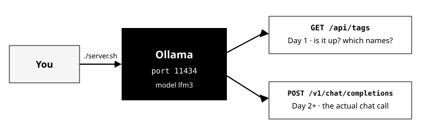
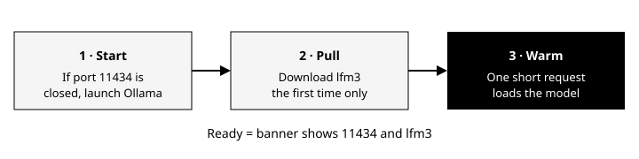
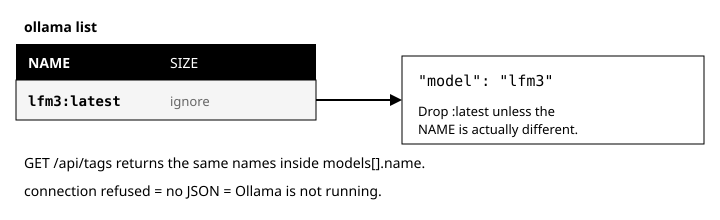
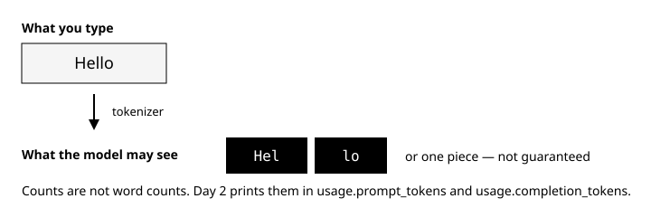
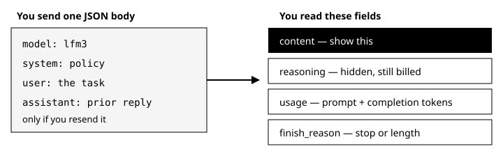
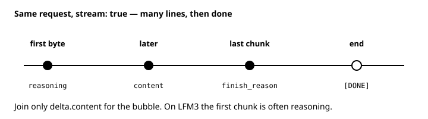
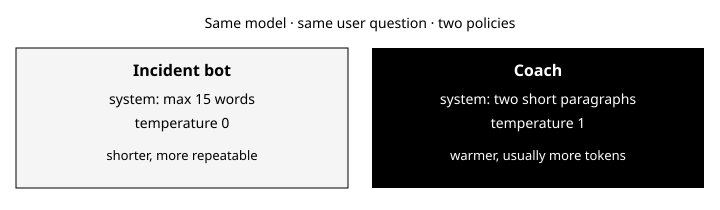
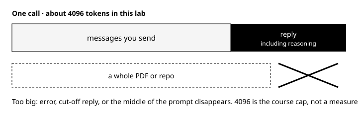

# Phase 0 — Bootstrap

**Days 1–7.** You run a small model on your machine and talk to it over HTTP. You do not train anything this week.

Runtime: [README.md](../README.md) · model **`lfm3`** · API `http://127.0.0.1:11434/v1` · next chapter [phase1.md](./phase1.md)

The roadmap UI is the exercise list. This page is the lesson those exercises assume.

---

## How the seven days fit

| Day | You can do this afterward |
|-----|---------------------------|
| **1** | Start Ollama, prove which model name the API expects, and define token and context in your own words |
| **2** | Send one chat request, save the JSON, and read content, reasoning, usage, and `finish_reason` |
| **3** | Turn on streaming, watch chunks arrive, and join only the user-visible text |
| **4** | Change tone with a system prompt and temperature, without swapping models |
| **5** | Show what happens when one prompt is too big, and say why retrieval exists |
| **6** | Pick a capstone and name the first technique you will try |
| **7** | Demo a batch call and a stream from memory |

Stay on **`lfm3`** all week. Embeddings and extra models come later ([ROADMAP](./ROADMAP.md)).

---

## The two URLs



**Ollama** runs on your computer. It loads a model into memory and serves HTTP on **port 11434**. `./server.sh` starts it if needed, pulls **`lfm3`** the first time, and sends one small warm-up request.



| Call | Purpose |
|------|---------|
| `GET http://127.0.0.1:11434/api/tags` | Inventory: is Ollama up, which model names exist? |
| `POST http://127.0.0.1:11434/v1/chat/completions` | Chat API (OpenAI-compatible). Used from Day 2 on. |

There is no separate `/health` endpoint here. JSON from `/api/tags` means the service is running.

| Symptom | Likely cause |
|---------|----------------|
| `connection refused` | Nothing on 11434 — run `./server.sh` |
| JSON with `"models": [...]` | Service up; you have not called the model yet |
| `model not found` on chat | `"model"` string does not match `ollama list` |

Use **`lfm3`** as `"model"` in this lab. If the list shows `lfm3:latest`, you still send `lfm3` unless the NAME column differs.



Copy only the **NAME** column from `ollama list` into JSON—not size or modified time.

```json
{
  "models": [
    { "name": "lfm3:latest" }
  ]
}
```

`connection refused` is curl text, not JSON: nothing is listening on 11434.

---

## A token



Models read **tokens** (subword pieces), not words. A **tokenizer** produces those pieces; you read counts from the API, not by counting characters.

| Input | Typical token behavior |
|-------|------------------------|
| `hello` | Often one token |
| ` Hello` (leading space) | Often two tokens |
| JSON / code | Usually more tokens than plain prose |
| Short visible reply on LFM3 | Can still be large `completion_tokens` if reasoning is long |

| Field | Counts |
|-------|--------|
| `usage.prompt_tokens` | Everything you sent in `messages` |
| `usage.completion_tokens` | Everything the model generated (including reasoning on LFM3) |
| `usage.total_tokens` | Sum — used for limits and billing |

Character length on screen is a weak proxy. Two paragraphs of JSON can exceed two paragraphs of English in token count.

---

## One chat request



Non-streaming chat is one HTTP POST and one JSON body back. That is what batch jobs, tests, and saved artifacts use.

```json
{
  "model": "lfm3",
  "messages": [
    {"role": "system", "content": "Reply in at most 15 words."},
    {"role": "user", "content": "What is a token?"}
  ]
}
```

| Field | Role |
|-------|------|
| `model` | Must be `lfm3` for this lab |
| `messages` | The whole conversation you want the model to see, in order |
| `role: system` | Policy: format, tone, refusals. Optional but powerful |
| `role: user` | The task |
| `role: assistant` | A previous reply you are sending back so the next turn has memory |
| `temperature` | Optional. `0` is steadier; `1` varies more. Omit it and the server default applies |
| `stream` | Omit it or set `false` for one JSON object. `true` is Day 3 |

The server does **not** remember the last curl. A second question only “knows” the name Sam if your new `messages` array still contains that earlier turn.

---

## Reading the response

A successful batch call looks like this (fields trimmed):

```json
{
  "model": "lfm3",
  "choices": [
    {
      "message": {
        "role": "assistant",
        "content": "Hello! How can I help you today?",
        "reasoning": "The user greeted me…"
      },
      "finish_reason": "stop"
    }
  ],
  "usage": {
    "prompt_tokens": 11,
    "completion_tokens": 135,
    "total_tokens": 146
  }
}
```

| Field | Use it for |
|-------|------------|
| `choices[0].message.content` | Text you show the user |
| `choices[0].message.reasoning` | LFM3’s hidden thinking. Often most of the completion tokens. Do not show it by accident |
| `finish_reason: stop` | The model finished on its own |
| `finish_reason: length` | It hit a token cap. The answer may be cut off |

Day 2 saves this object to `examples/day02-response.json` so you can re-read it without scrolling a terminal.

---

## Streaming



Same URL, same `messages`, plus `"stream": true`. The body is not one JSON object. It is **server-sent events**: many lines, then a done marker.

```text
data: {"choices":[{"delta":{"reasoning":"The user wants a short reply."}}]}

data: {"choices":[{"delta":{"content":"OK"}}]}

data: {"choices":[{"finish_reason":"stop"}]}

data: [DONE]
```

| Piece | Meaning |
|-------|---------|
| `data:` | One chunk. The JSON after the prefix is the payload |
| `delta.reasoning` | More hidden thinking. On LFM3 this often arrives **before** any visible text |
| `delta.content` | The next piece of user-visible text. Join these strings in order |
| `finish_reason` | Same meanings as batch, usually on a later chunk |
| `data: [DONE]` | The stream is finished |

**Time to first token** is how long until the first `data:` line. People feel that delay more than the time until `[DONE]`. If the first chunk is only reasoning, the metric looks fast while the user still sees a blank bubble. `curl -N` turns off buffering so you see lines as they arrive. `curl`’s `%{time_starttransfer}` is a practical stand-in for that first-byte time.

Use streaming when a person is watching. Use one JSON object when a job must store a record.

---

## Steering without a new model



Day 4 asks the same question twice.

```json
{"role": "system", "content": "Reply in at most 15 words. No preamble."}
{"role": "user", "content": "Explain what a token is in one sentence."}
```

The system message is the policy. The user message is the task. Putting the policy only in the user text is weaker.

`temperature: 0` with a strict system message is the incident-bot profile: shorter, more repeatable. `temperature: 1` with a looser system message is the coach profile: warmer, longer, less identical run to run. Phase 1 adds Top-P and other samplers. This week, system text plus temperature is enough to see that style is a request field, not a new model.

---

## The context budget



One API call has **one token budget** shared by:

1. System and user messages you send (including history you resend)
2. The model’s new output (including reasoning on LFM3)

This lab uses **about 4096 tokens** as a working cap so exercises stay comparable—not a number you measure on Day 1, and often below marketing “context length” on model cards. Rough scale: a few thousand words of English, not a PDF or a repository.

When input is too large, runtimes may error, return `finish_reason: length`, or truncate (often the middle). Pasting an entire document into one user message is a common failure mode—not a curl bug.

Day 5 uses a long prompt ending in `MAGICEND`. If the model never mentions `MAGICEND`, it likely did not attend to the end of the prompt.

Phase 2 (RAG) retrieves small relevant chunks instead of sending whole files. The same budget still applies: rules, chunks, question, and answer must all fit.

---

## What Day 7 should sound like

Without this page open, you can:

- Start the service and name the base URL and the model id
- Define a token and a context window
- Run one batch chat and one stream
- Say what `content`, `reasoning`, `usage`, and `finish_reason` are for

A journal line that only says “pieces of text” is not done. A done line names subword pieces and `usage.prompt_tokens` / `usage.completion_tokens`.

---

## If the command fails

| What you see | What it usually means |
|--------------|------------------------|
| `connection refused` on port 11434 | Ollama is not up. Run `./server.sh` |
| `model not found` | The `model` string does not match `ollama list` |
| Tiny `content`, huge `completion_tokens` | Reasoning was generated. Read `message.reasoning` |
| `finish_reason` is `length` | A cap cut the answer short |
| The model “forgets” the last curl | You did not resend that turn in `messages` |
| A long paste answers the wrong thing | The context budget ate the instruction or the ending |

---

## Glossary

| Term | In this lab |
|------|-------------|
| **Ollama** | The local server that loads `lfm3` and serves HTTP |
| **lfm3** | The only model id you pass this week |
| **Token** | A subword piece. Counts are in `usage` |
| **Context window** | Token budget for one request, prompt and reply together |
| **Reasoning** | Hidden generation on LFM3. It spends completion tokens |
| **Batch** | `stream` off. One JSON body |
| **Stream** | `stream: true`. Many `data:` lines |
| **TTFT** | Time until the first streamed chunk |
| **System prompt** | Policy message. Not the user’s question |
| **Temperature** | How much the wording is allowed to vary |

---

## Related

[DAILY_30MIN.md](./DAILY_30MIN.md) · [revision/phase0-bootstrap.md](../revision/phase0-bootstrap.md) · [phase1.md](./phase1.md)
